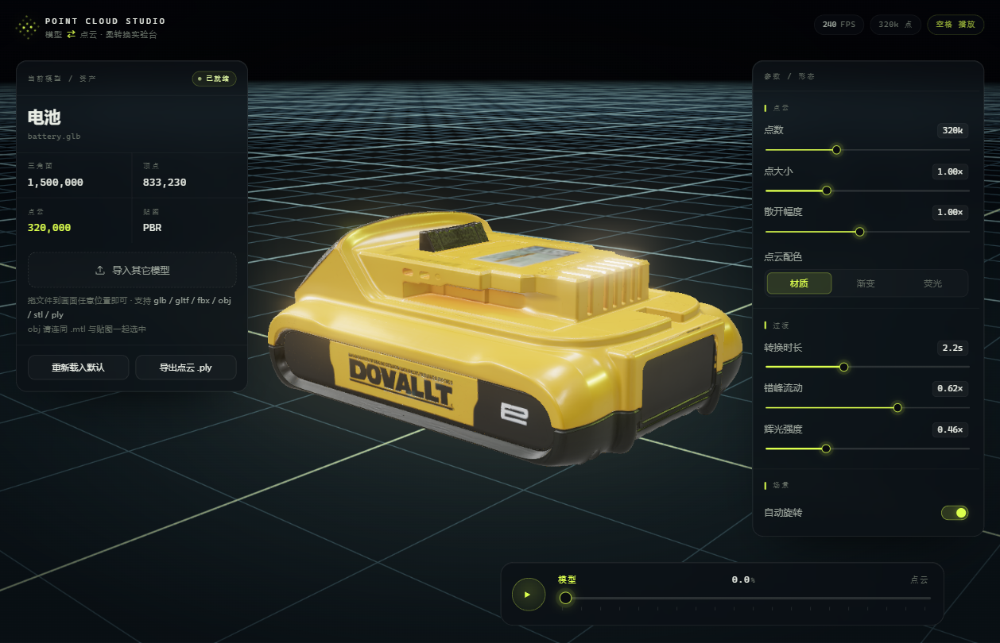
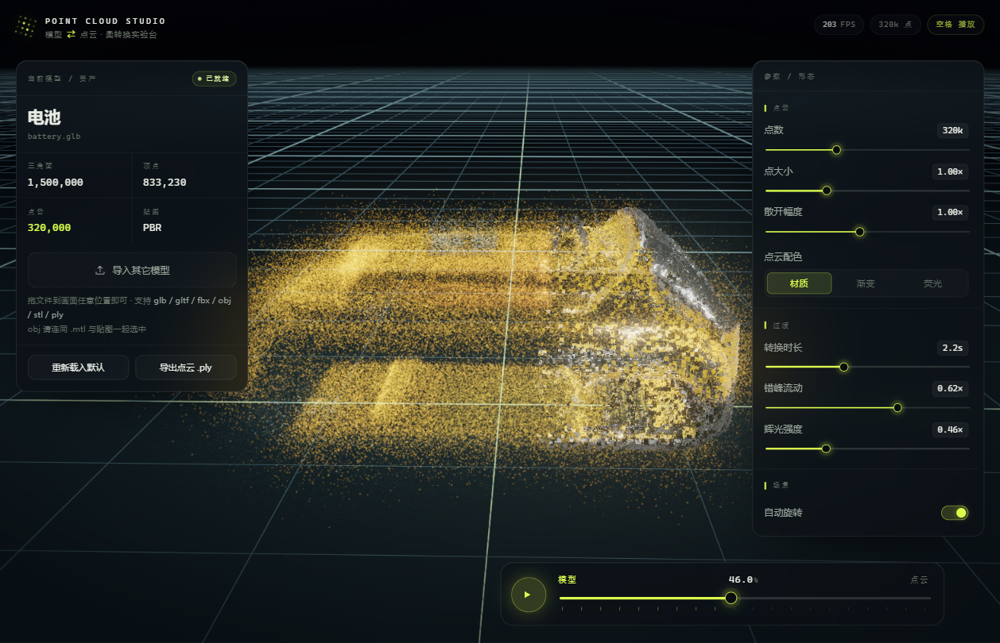
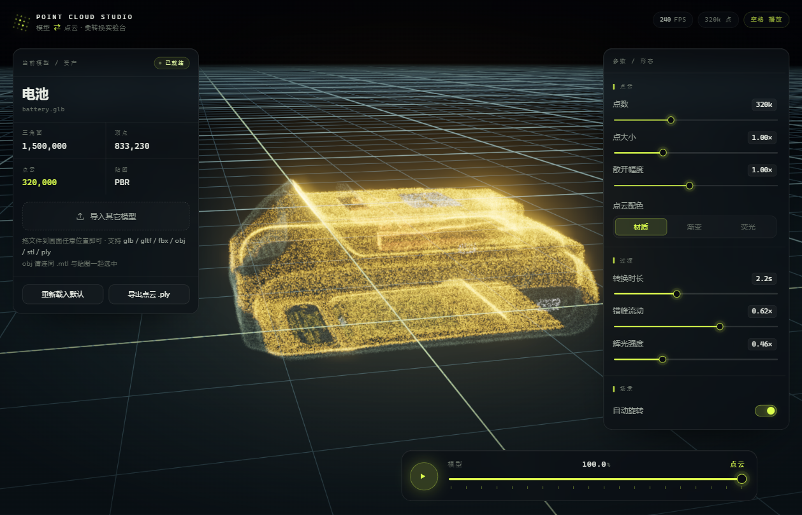
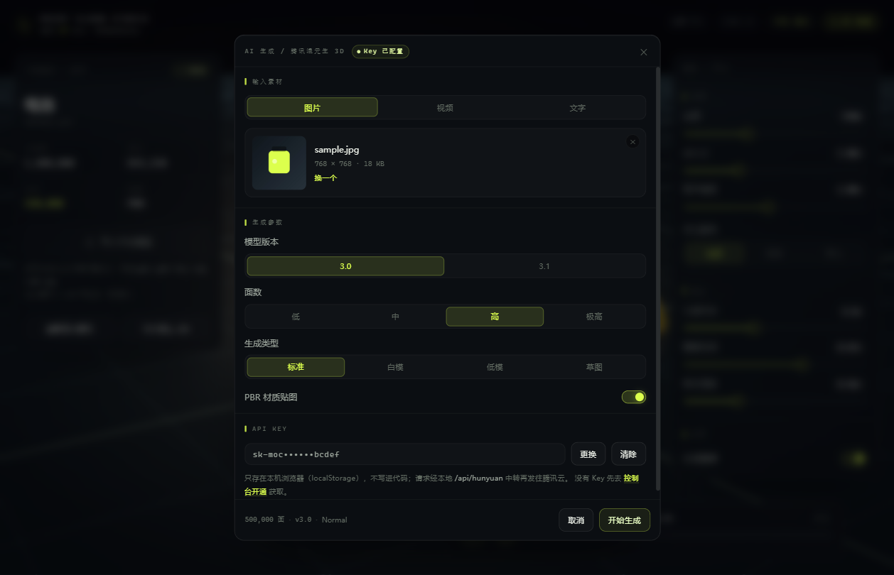
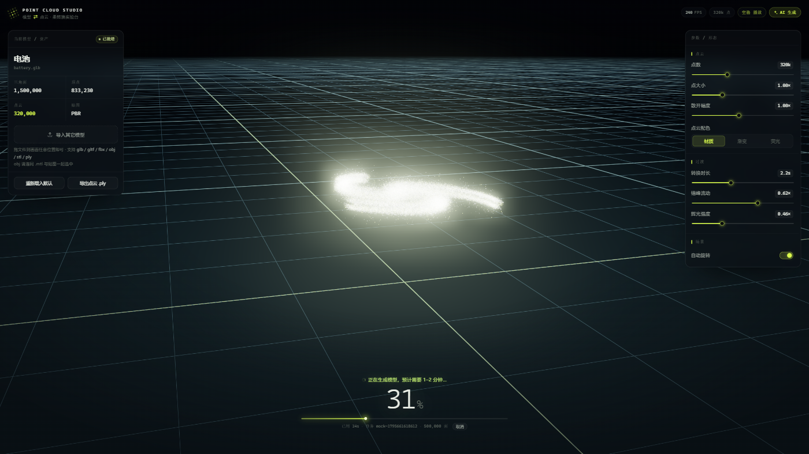
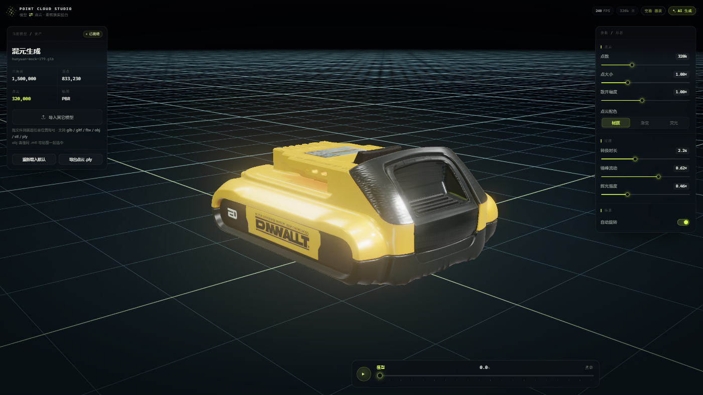
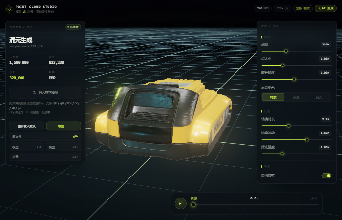

# POINT CLOUD STUDIO · 模型 ⇄ 点云

把 3D 模型实时拆成点云、再收拢回实体的网页实验台。Vue 3 + Vite + Three.js（WebGL2），粒子采样跑在 Web Worker 里。

| 实体 | 转换中 | 点云 |
| --- | --- | --- |
|  |  |  |

| AI 生成配置 | 生成中（假点云 + 进度） | 完成 | 导出 |
| --- | --- | --- | --- |
|  |  |  |  |

## 跑起来

```bash
cd pointcloud-studio
npm install

# 默认模型不在仓库里（78 MB），放一个进来才有首屏模型
mkdir -p public/models
cp "你的模型.glb" public/models/battery.glb

npm run dev        # http://127.0.0.1:5183（真实混元接口）
```

> 没放模型也能跑：页面照常打开，把模型拖进窗口即可加载。详见 [public/models/README.md](public/models/README.md)。

没有 API Key 也想看完整流程：`npm run dev:mock`（:5184，本地假任务，18 秒后返回电池模型）。

生产构建：`npm run build` → `dist/`，然后 `npm start`（`node server/index.mjs`，自带混元中转 + 静态托管）。

**不想敲命令**：运行包里的 `点云实验室.exe` 双击即用（找 Node → 起服务 → 等端口通了自动开浏览器；没装 Node 会弹框提示）。它的源码在 `tools/launcher.cs`，`npm run exe` 重新编译（用系统自带 `csc.exe`，不需要装 VS）。

详细的启动步骤、打包分发、常见问题见 **[启动说明.md](启动说明.md)**。

## 能做什么

| 能力 | 说明 |
| --- | --- |
| 默认模型 | `public/models/battery.glb`（DEWALT 电池，150 万三角面 / 3 张贴图） |
| 模型 → 点云 | 320k 采样点（可 40k ~ 1.2M），材质贴图逐点着色 |
| 点云 → 模型 | 同一条时间轴反向播放，错峰粒子飞回表面并重新拼成实体 |
| 柔转换 | 每个点按「高度 58% + 随机 42%」拿到自己的延迟，GPU 顶点着色器各自 `smoothstep`；飞行中途向外炸成弧线、落点精确回到表面，同时网格沿法线膨胀 + 同一套颗粒噪声 `discard` 溶解 |
| 导入其它模型 | 拖进窗口任意位置，或点「导入其它模型」。支持 `glb / gltf / fbx / obj / stl / ply`；obj 请连同 `.mtl` 与贴图一起多选 |
| 导出 | 左面板「导出」展开四项：原文件（AI 生成时才有，原样二进制）/ 模型 `.glb`（含贴图）/ 模型 `.stl`（二进制）/ 点云 `.ply`（含法线与 RGB） |
| 地面 | 着色器网格：1m 细格 + 5m 主格，`fwidth` 抗锯齿、径向渐隐、主轴线、过渡时从中心扩散的波纹 |
| 参数 | 点数、点大小、散开幅度、点云配色（材质 / 高度渐变 / 荧光）、转换时长、错峰流动、辉光、自动旋转 |

## AI 生成（腾讯混元 3D）

左侧「当前模型 / 资产」面板下方那张 **AI 生成 3D 模型** 卡片：给一张图、一组多视角图、一段视频或一句描述，就能生成模型并直接落进这个点云实验台。

- **Key 自己填、随时换**：面板里的 `API KEY` 输入后点「保存」，只存在浏览器 `localStorage`（`pcs.hunyuan.key`），不进代码、不进构建产物；「更换 / 清除」随时切换。没有配置时「开始生成」是灰的。
- **图片**：`jpg / png / webp`，自动缩到长边 2048 再转 JPEG 上传（接口限制 base64 后 ≤6MB、单边 128–5000）。
- **多视角（2–8 张）**：图片 tab 里切到「多视角 2–8」，3×3 栅格里按真实视角位摆 8 个槽（左前 45° / 顶视 / 右前 45° / 左视 / 右视 / 背视 / 正视 / 底视），中间是已选计数。点空格子选图、拖图进去也行，右下角 ✕ 单独移除；至少 2 张才能开始生成。含顶 / 底 / 两个 45° 视角时会自动把模型版本切到 **3.1**（这些视角 3.0 不支持），并为它们打上 `3.1` 徽标。
- **视频**：浏览器里抽帧（默认 6 帧、跳过首尾 8%），按梯度能量自动挑最清晰的一帧当首图，也可以自己点选别的帧。接口没有视频入参，所以视频必然是「抽帧 → 图生 3D」。
- **参数**：模型版本 3.0 / 3.1、面数 低 20k / 中 150k / 高 500k / 极高 1.5M、生成类型（标准 Normal / 白模 Geometry / 低模 LowPoly / 草图 Sketch；**3.1 不支持低模与草图**）、PBR 贴图开关、提示词（文字模式，或草图模式下与图共存）。
- **等待动画**：生成期间视口里是一团会自己换形状、缓慢自转漂移的假点云雕塑（环面结 / 双螺旋 / 球壳 / 星系 / 圆角立方轮换），下方是倒计时文案 + 大号百分比 + 进度条。百分比来自真实任务状态（`WAIT / RUN / DONE`），只在阶段内做缓动；未知阶段只在阶段内插值，不会假报 100%。
- **收尾**：拿到结果 → 下载 GLB → 载入场景 → **先以点云形态出现，再自动收拢成实体**，直接复用主页面的「点云 → 模型」柔转换。

架构上 Key 不直连腾讯云：浏览器 → 本地中转 `/api/hunyuan/{submit,query,file}` → 腾讯云。中转只在内存里转发，不落盘、不写日志；下载结果的 COS 链接也由 `file` 端点流式转发（白名单只放行 `https` + 腾讯云域名，避免变成开放代理）。

## 导出

左面板「导出 ▾」展开四项，导出的对象都是当前视口里的模型（已做过归一化：等比缩放到 2.6 单位、XZ 居中、底面贴地）：

| 项 | 内容 | 什么时候有 |
| --- | --- | --- |
| 原文件 `.glb` | 混元返回的原始文件，**字节级原样**下载（不重编码、不丢贴图） | 只有 AI 生成的模型才有 |
| 模型 `.glb` | 当前场景导出 glTF 二进制，带贴图（单张压到 2048） | 始终 |
| 模型 `.stl` | 二进制 STL，纯几何，给切片软件用 | 始终 |
| 点云 `.ply` | 当前采样点云，二进制，含法线与 RGB | 始终 |

导出前会把材质上注入的溶解着色器摘掉（`onBeforeCompile` 复原），所以导出的文件在任何软件里都是干净的实体，不会带上「只在浏览器里存在」的着色器。

导出的 `.glb` 会保留场景里的归一化变换（外层 `convert` 节点带约 2.56 倍缩放与平移），打开就是你在页面上看到的尺寸；`.stl` 同理，底面贴地。

## 操作

- `空格` 播放 / 暂停转换
- 拖动旋转、滚轮缩放、右键平移
- 底部滑杆可直接拖动到任意中间状态
- 窄屏（<1080px）左下角出现两个按钮，分别抽屉式展开左右面板

## 代码结构

```
src/
  App.vue                     编排：载入、导入、键盘/拖拽、面板与滑杆同步、AI 生成流程
  store.js                    全局 ui 状态（reactive，含 ui.gen 生成子状态）
  api/hunyuan.js              混元接口：提交/轮询/下载、Key 存取、图片压缩
  utils/videoFrames.js        视频抽帧 + 清晰度打分
  three/
    Studio.js                 场景、相机、Bloom 合成链、模型与点云的加载/切换/导出
    pointCloudMaterial.js     粒子着色器（错峰 + 弧线飞行 + 三种配色）与几何构建
    MeshDissolve.js           onBeforeCompile 注入的实体溶解（与粒子同尺度噪声）
    GridFloor.js              地面网格着色器（双层格 + 辉光 + 波纹）
    GenerationCloud.js        生成等待期的假点云雕塑（五种形状轮换）
  workers/samplePoints.worker.js   面积 CDF 采样、贴图取色、散开方向/延迟/尺寸
  loaders/loadModel.js        glb/gltf/fbx/obj/stl/ply 载入、归一化、贴图提取、内存缓冲载入
  components/                ModelPanel / ControlPanel / MorphBar / SliderRow / LoadingVeil
                             GeneratePanel（生成配置）/ GenOverlay（生成中进度）/ Icon（统一图标）
server/
  hunyuan.mjs                 混元接口中转（connect 中间件，支持 mock）
  index.mjs                   生产：静态托管 dist + 中转
scripts/
  make-favicon.cjs            生成标签图标：favicon.svg + 32/180/512 的 PNG（自带光栅化）
```

标签图标是这个项目的品牌标记（`public/favicon.svg`：一圈八点 + 中心一点，酸柠色）。想改配色或点阵，编辑 `scripts/make-favicon.cjs` 顶部的几何与 `BG` / `ACCENT`，然后 `npm run icon` 重新生成 —— 它自己把矢量光栅化成 PNG，不依赖 sharp 之类的外部库。

转换是纯 GPU 的：320k 点每帧只有一次 `uMorph` uniform 更新，150 万面的实体同理（溶解靠 uniform 驱动），所以在核显上也能 200+ FPS。

## 关于默认模型

仓库**不包含**默认模型 `public/models/battery.glb`——它是一个 78 MB 的 150 万面电池，塞进 git 会让每次克隆都多拉 78 MB，GitHub 也会因为超过 50 MB 报警告。样例图里的电池就是这么来的，你自己放一个同名的进去即可：

```bash
mkdir -p public/models
cp "你的模型.glb" public/models/battery.glb
```

`public/models/` 下的模型/贴图已在 `.gitignore` 里，不会被误提交。

文件名保持 `battery.glb` 就不用改代码；要换名字改两处：

- `src/three/Studio.js` 里 `loadDefault('/models/battery.glb')`
- `src/App.vue` 里 `boot()` 的 `DEFAULT_MODEL`

支持 glTF/GLB、FBX、OBJ（连同 .mtl 与贴图）、STL、PLY。任何模型都会被自动等比缩放到 2.6 单位、XZ 居中、底面贴地。

**不放也能用**：首屏只有地面网格，把模型拖进窗口或点左下「导入其它模型」就行。
